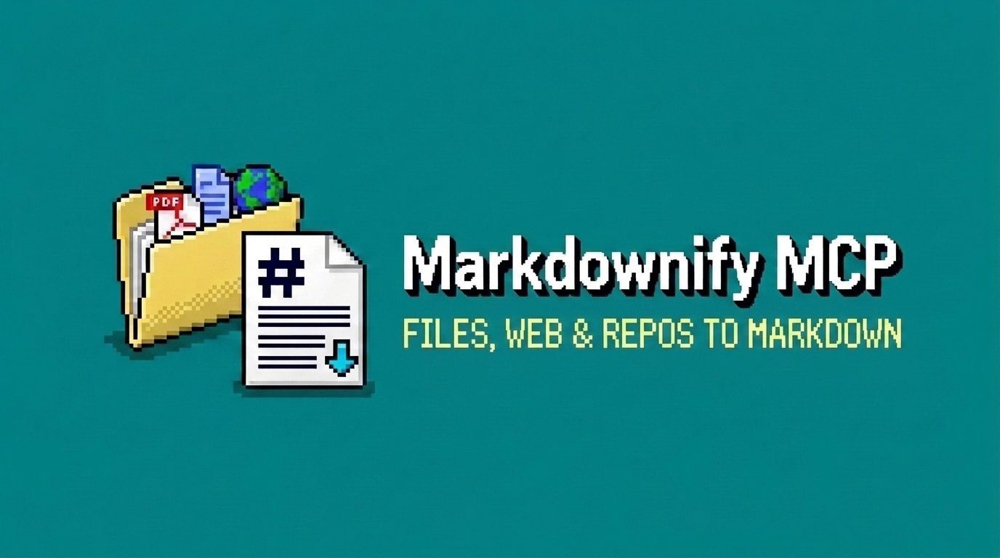

# Markdownify MCP Server



Markdownify is a single-operator, stateless Model Context Protocol (MCP) server (built on MCP TypeScript SDK v2) that converts local files, web URLs, and public Git repositories to Markdown and retrieves existing Markdown files.

<a href="https://glama.ai/mcp/servers/bn5q4b0ett"></a>

## Features

- **Convert local files to Markdown** (absolute or `~/` paths):
  - PDF, DOCX, XLSX, PPTX
  - Images (EXIF/metadata extraction without external vision LLMs)
  - Audio (speech transcription via `markitdown[all]`, requires network speech recognition)
- **Convert web content to Markdown** (public `http(s)` URLs with SSRF protection on every redirect hop):
  - General webpages and hosted documents (PDF, DOCX, XLSX, PPTX, images, etc.)
  - YouTube video transcripts
  - Bing search results
- **Convert public Git repositories to Markdown** via Repomix (`http(s)` URL or GitHub `owner/repo` shorthand, with optional branch/tag/commit and Tree-sitter `--compress`)
- **Retrieve existing Markdown files** (`.md` / `.markdown`, case-insensitive, verbatim UTF-8 + resolved `realpath`)
- **Cross-provider MCP alignment** (Anthropic Claude, Google Gemini, OpenAI ChatGPT / Agents SDK):
  - Complete explicit `ToolAnnotations`, top-level `Tool.title`, server `instructions`, `Implementation` metadata, and static `cacheHints`
  - Gemini-safe flat JSON Schema `inputSchema` with strict per-tool runtime argument validation
  - Typed `outputSchema` and `structuredContent` alongside backwards-compatible `content` text blocks (untruncated; omitted on `isError: true`)
  - Operator-selectable **Toolset**: default 4-tool `compact` surface (`convert-web-url`, `convert-local-file`, `convert-git-repo`, `get-markdown-file`) or opt-in 11-tool `classic` surface (`--toolset=classic` / `MCP_TOOLSET=classic`)

> **Upgrading from v1.x (v2.0 breaking changes):** v2.0 defaults to the 4-tool `compact` Toolset (pass `--toolset=classic` or set `MCP_TOOLSET=classic` to restore the 11 v1 tool names), fails closed on local file tools in HTTP mode unless `MD_ALLOWED_PATHS` or `--allow-unrestricted-paths` is set, requires absolute or `~/` file paths, and rejects unknown/cross-tool argument keys strictly.

## Getting Started

Prerequisites:

- [Bun](https://bun.sh/) for JavaScript dependency management, builds, and tests.
- Node.js 22 or later (also used by the Repomix CLI).
- [uv](https://docs.astral.sh/uv/getting-started/installation/) on `PATH` for locked Python setup.
- Python 3.11–3.14. `uv` can install the development interpreter selected by `.python-version` if needed; Python 3.15 is not supported.

1. Clone this repository
2. Install dependencies:

   ```sh
   bun install --frozen-lockfile
   ```

   The `preinstall` step runs `uv sync --locked --extra all --no-dev`, creating `.venv` and installing MarkItDown's full feature set at the exact versions in `uv.lock`. Setup fails if the lockfile is stale or Python installation fails. If dependency lifecycle scripts are disabled, run `node preinstall.js` manually.

3. Build the project:

   ```sh
   bun run build
   ```

4. Start the server (runs over `stdio` by default):

   ```sh
   bun start
   ```

## Usage with MCP Clients (stdio)

Add Markdownify MCP to your desktop or CLI MCP client configuration (Claude Desktop, Claude Code, Gemini CLI, Codex CLI, etc.):

```json
{
	"mcpServers": {
		"markdownify": {
			"command": "node",
			"args": ["{ABSOLUTE PATH TO REPO}/dist/index.js"],
			"env": {
				"MD_ALLOWED_PATHS": "/path/to/allowed/docs"
			}
		}
	}
}
```

Markdownify MCP defaults to the 4-tool `compact` Toolset. Pass `"--toolset=classic"` in `args` (or set `"MCP_TOOLSET": "classic"` in `env`) to expose the 11 format-specific classic tools for legacy v1 clients. `MD_ALLOWED_PATHS` is optional in `stdio` mode (unrestricted when unset), and recommended whenever you want to bound local filesystem reads.

## Usage with HTTP (Streamable HTTP transport)

By default the server runs over `stdio`. To run it as a stateless Streamable HTTP server (listening on `127.0.0.1:3000/mcp` by default):

```sh
MD_ALLOWED_PATHS=/path/to/docs bun dist/index.js --transport=http --port=3000
```

Or via environment variables:

```sh
MCP_TRANSPORT=http MCP_PORT=3000 MD_ALLOWED_PATHS=/path/to/docs bun dist/index.js
```

### Server Configuration Flags & Environment Variables

CLI flags take precedence over environment variables. Enum values (`--transport`, `--toolset`, `MCP_TRANSPORT`, `MCP_TOOLSET`) are trimmed and lowercased; unknown flags or invalid values fail fast at startup.

| Flag / Env                                                    | Default                                 | Purpose                                                                                                                                                                                                                                       |
| ------------------------------------------------------------- | --------------------------------------- | --------------------------------------------------------------------------------------------------------------------------------------------------------------------------------------------------------------------------------------------- |
| `--transport=stdio\|http` / `MCP_TRANSPORT`                   | `stdio`                                 | Transport mode (`stdio` or stateless Streamable HTTP on `/mcp` and `/`).                                                                                                                                                                      |
| `--host=HOST` / `MCP_HOST`                                    | `127.0.0.1`                             | Bind address for HTTP mode. Defaults to loopback only.                                                                                                                                                                                        |
| `--port=N` / `MCP_PORT`                                       | `3000`                                  | Port for HTTP mode (`1`–`65535`; ignored in `stdio` mode).                                                                                                                                                                                    |
| `MCP_ALLOWED_HOSTS`                                           | loopback hosts when bound to loopback   | Comma-separated list of allowed `Host` headers (DNS-rebinding protection; returns HTTP 403 on mismatch).                                                                                                                                      |
| `MCP_ALLOWED_ORIGINS`                                         | loopback origins when bound to loopback | Comma-separated list of allowed browser `Origin` headers (returns HTTP 403 on mismatch).                                                                                                                                                      |
| `--allow-unrestricted-paths` / `MCP_ALLOW_UNRESTRICTED_PATHS` | `false`                                 | Opt out of HTTP fail-closed local file blocking when `MD_ALLOWED_PATHS` is unset.                                                                                                                                                             |
| `--toolset=compact\|classic` / `MCP_TOOLSET`                  | `compact`                               | Active **Toolset**: `compact` (default) exposes 4 capability-aligned tools (`convert-web-url`, `convert-local-file`, `convert-git-repo`, `get-markdown-file`) to save prompt tokens; `classic` (opt-in) exposes all 11 format-specific tools. |

> **Security note:** The HTTP transport has no built-in authentication. When `MD_ALLOWED_PATHS` is unset in HTTP mode, local file-input tools (`*-to-markdown`, `convert-local-file`, and `get-markdown-file`) fail closed with `isError: true` unless you explicitly opt out with `--allow-unrestricted-paths` or `MCP_ALLOW_UNRESTRICTED_PATHS=true`, while Web URL and Git Repository tools remain available. Keep `--host=127.0.0.1` for local use, or place the server behind an authenticating reverse proxy with `MCP_ALLOWED_HOSTS` / `MCP_ALLOWED_ORIGINS` configured.

### Paths & Conversion Limit Environment Variables

All paths and limits default to sensible bounds; override only when needed.

| Variable                   | Default                                                              | Purpose                                                                                                                                                                                                                                           |
| -------------------------- | -------------------------------------------------------------------- | ------------------------------------------------------------------------------------------------------------------------------------------------------------------------------------------------------------------------------------------------- |
| `MARKITDOWN_PATH`          | `<project>/.venv/bin/markitdown`, then `markitdown` on `PATH`        | Absolute path to the `markitdown` executable (for example when using `pipx install "markitdown[pdf]"` instead of the bundled `.venv`).                                                                                                            |
| `REPOMIX_PATH`             | `<project>/node_modules/.bin/repomix`, then `repomix` on `PATH`      | Absolute path to the `repomix` executable used by `git-repo-to-markdown` / `convert-git-repo`.                                                                                                                                                    |
| `MD_ALLOWED_PATHS`         | unset (unrestricted in `stdio`; local file tools disabled in `http`) | Path-delimiter-separated list (`:` on POSIX, `;` on Windows) of directories allowed for local reads (enforced after `~` expansion and `realpath` symlink resolution). Setting an empty or delimiter-only value fails closed for local file tools. |
| `MD_FETCH_TIMEOUT_MS`      | `30000`                                                              | Per-request Web URL HTTP fetch timeout in milliseconds.                                                                                                                                                                                           |
| `MD_MAX_DOWNLOAD_BYTES`    | `26214400` (25 MB)                                                   | Maximum downloaded response size in bytes for Web URL conversions.                                                                                                                                                                                |
| `MD_MAX_REDIRECTS`         | `10`                                                                 | Maximum HTTP redirects followed per Web URL conversion (each hop is SSRF-validated).                                                                                                                                                              |
| `MD_MARKITDOWN_TIMEOUT_MS` | `60000`                                                              | Subprocess timeout in milliseconds for `markitdown` conversions.                                                                                                                                                                                  |
| `MD_REPOMIX_TIMEOUT_MS`    | `120000`                                                             | Subprocess timeout in milliseconds for `repomix` Git repository packing.                                                                                                                                                                          |

## Usage with Docker

Build and run over `stdio`:

```sh
docker build -t markdownify-mcp .
docker run --rm -i \
  -v "$HOME/Documents:/data:ro" \
  -e MD_ALLOWED_PATHS=/data \
  markdownify-mcp
```

Or run over Streamable HTTP:

```sh
docker run --rm \
  -p 127.0.0.1:3000:3000 \
  -v "$HOME/Documents:/data:ro" \
  -e MD_ALLOWED_PATHS=/data \
  -e MCP_ALLOWED_HOSTS=127.0.0.1:3000,localhost:3000 \
  markdownify-mcp --transport=http --host=0.0.0.0 --port=3000
```

Notes for Docker (`Dockerfile` / `mcp/markdownify`):

- Mount any host directories you want the server to read into the container, then pass the **container** paths to the tools (e.g. `/data/foo.pdf`, not `/Users/you/Documents/foo.pdf`).
- Set `MD_ALLOWED_PATHS` to the colon-separated list of mounted directories so the server enforces a read boundary matching the bind mount.
- The Docker image installs the slim locked `pdf` profile (`uv sync --locked --extra pdf`) rather than `all`. PDFs, webpages, Git repositories, Markdown retrieval, and image metadata work in the slim image, while Office documents (`docx-to-markdown`, `xlsx-to-markdown`, `pptx-to-markdown`) and audio transcription (`audio-to-markdown`) require `markitdown[all]` and return an actionable error pointing to the full local install (`bun install --frozen-lockfile`).

## Available Tools

### Compact Toolset (default, `--toolset=compact`)

By default, Markdownify MCP exposes 4 capability-aligned tools designed for minimal token overhead across Anthropic, Gemini, and OpenAI hosts:

- `convert-web-url`: Convert any public `http(s)` webpage, YouTube video, Bing search page, or hosted document to Markdown
- `convert-local-file`: Convert any local non-Markdown file (PDF, DOCX, XLSX, PPTX, image, audio) to Markdown
- `convert-git-repo`: Convert a public remote Git repository (`http(s)` URL or GitHub `owner/repo` shorthand) into a single Markdown document (optional `branch` and `compress`)
- `get-markdown-file`: Retrieve an existing local `.md` or `.markdown` file (case-insensitive) verbatim along with its resolved `realpath`

### Classic Toolset (opt-in, `--toolset=classic` / `MCP_TOOLSET=classic`)

For backwards compatibility with v1 clients or format-specific tool routing, pass `--toolset=classic` (or set `MCP_TOOLSET=classic`) to expose the 11 format-specific tools:

- `youtube-to-markdown`: Convert YouTube videos to Markdown
- `pdf-to-markdown`: Convert local PDF files to Markdown
- `bing-search-to-markdown`: Convert Bing search result pages to Markdown
- `webpage-to-markdown`: Convert public `http(s)` webpages and hosted documents to Markdown
- `image-to-markdown`: Convert local images to Markdown with metadata (returns empty text when no metadata is present without an external vision LLM)
- `audio-to-markdown`: Convert local audio files to Markdown with speech transcription (requires `markitdown[all]` and network access for Google Speech Recognition)
- `docx-to-markdown`: Convert local DOCX files to Markdown (requires `markitdown[all]`)
- `xlsx-to-markdown`: Convert local XLSX files to Markdown (requires `markitdown[all]`)
- `pptx-to-markdown`: Convert local PPTX files to Markdown (requires `markitdown[all]`)
- `git-repo-to-markdown`: Convert a public remote Git repository (`http(s)` URL or GitHub `owner/repo` shorthand) into a single Markdown document (optional `branch` and `compress`)
- `get-markdown-file`: Retrieve an existing local `.md` or `.markdown` file (case-insensitive) verbatim along with its resolved `realpath`

### Key Tool Behavior & Limits

- **Strict argument validation:** Every tool validates arguments strictly against the active Toolset and rejects unknown/cross-tool keys (e.g. `file_path` instead of `filepath`) or unexposed tool names with a single-line `isError: true` error.
- **Structured outputs:** Successful calls return full untruncated Markdown in both `content` text blocks and `structuredContent` (`{ markdown }` for conversions; `{ path, markdown }` for `get-markdown-file`). Error responses (`isError: true`) omit `structuredContent`.
- **Local paths:** All local file tools and `get-markdown-file` require absolute or `~/` paths (bare relative paths are rejected), validate `MD_ALLOWED_PATHS` after `realpath` resolution before checking existence, and verify the target is a readable regular file.
- **Web URLs:** Non-`http(s)` schemes and private/loopback/link-local/reserved IPs are blocked on the initial URL and every redirect hop. Non-2xx responses fail with the HTTP status code, and unconverted raw HTML (such as client-only JS SPAs) fails cleanly.

## Development & Testing

```sh
bun run dev                        # TypeScript compiler in watch mode
bun run lint                       # Biome lint + format check (bun run format to auto-fix)
bun run build                      # Typecheck and compile to dist/
bun test                           # Run Bun unit, boundary, HTTP, and scenario tests
bun run harness                    # Interactive mock DD harness (type help)
bun run harness run scenarios      # Replay all deterministic mock scenarios
bun run harness live scenarios/live # Run live checks against real local tools/fs
bun run harness docker             # Build and verify slim Docker stdio + HTTP container
```

### Multi-Form-Factor End-to-End Verification

Verify the server as a real MCP SDK client across all six Form Factors (`node-stdio`, `bun-stdio`, `local-http`, `docker-stdio`, `docker-http`, `npm-package`) and both Toolsets (`classic` and `compact`):

```sh
# Fast local stdio run across curated corpus categories with output previews
bun run harness e2e --form=node-stdio --preview

# Offline local binaries across local stdio & HTTP in opt-in classic Toolset mode
bun run harness e2e --form=node-stdio,bun-stdio,local-http --toolset=classic --category=local-binary

# Ad-hoc probe against any URL or local file
bun run harness e2e --form=node-stdio --tool=convert-web-url --url=https://www.iana.org/domains/reserved
bun run harness e2e --form=node-stdio --tool=get-markdown-file --file=/path/to/README.md

# Full 6-Form-Factor matrix (requires Docker daemon and outbound network)
bun run harness e2e --all
```

Exit codes: `0` = all passed, `1` = one or more `FAIL`s, `2` = zero `FAIL`s with one or more upstream `BLOCKED` targets (rate limits / bot walls).

GitHub Actions runs offline 6-Form-Factor verification on every PR ([`.github/workflows/ci.yml`](.github/workflows/ci.yml)) and full real-internet 6-Form-Factor verification weekly / on-demand ([`.github/workflows/e2e-live.yml`](.github/workflows/e2e-live.yml)).

### Updating Dependencies

Normal installs consume the committed lockfiles; they do not upgrade packages.

- JavaScript: update the intended ranges in `package.json`, run `bun update --ignore-scripts`, then commit `package.json` and `bun.lock`.
- Python: update `pyproject.toml` as needed, run `uv lock --upgrade`, then commit `pyproject.toml` and `uv.lock`. Both the local `all` and Docker `pdf` profiles are resolved in this one lockfile.
- Verify with `uv lock --check`, `node preinstall.js`, `bun run lint`, `bun run build`, `bun test`, `bun run harness run scenarios`, and `bun run harness docker` (or `bash scripts/docker-smoke-test.sh`) when Docker is available.

## Contributing

Contributions are welcome! Please feel free to submit a Pull Request.

## License

This project is licensed under the MIT License - see the [LICENSE](LICENSE) file for details.
